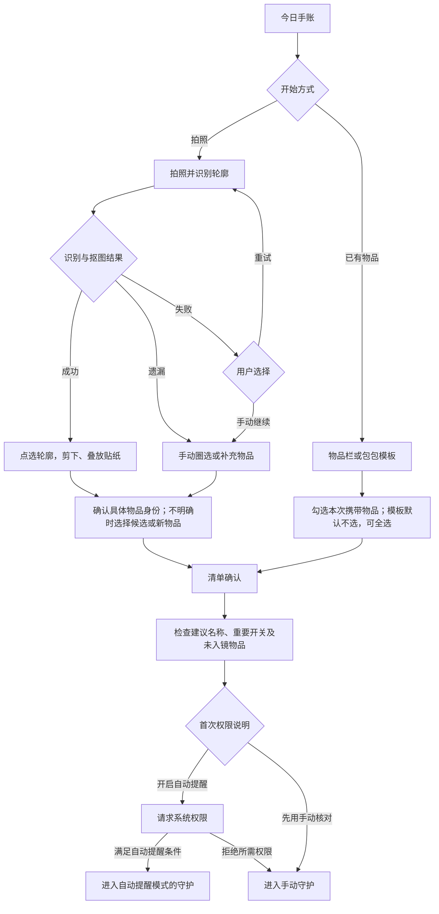
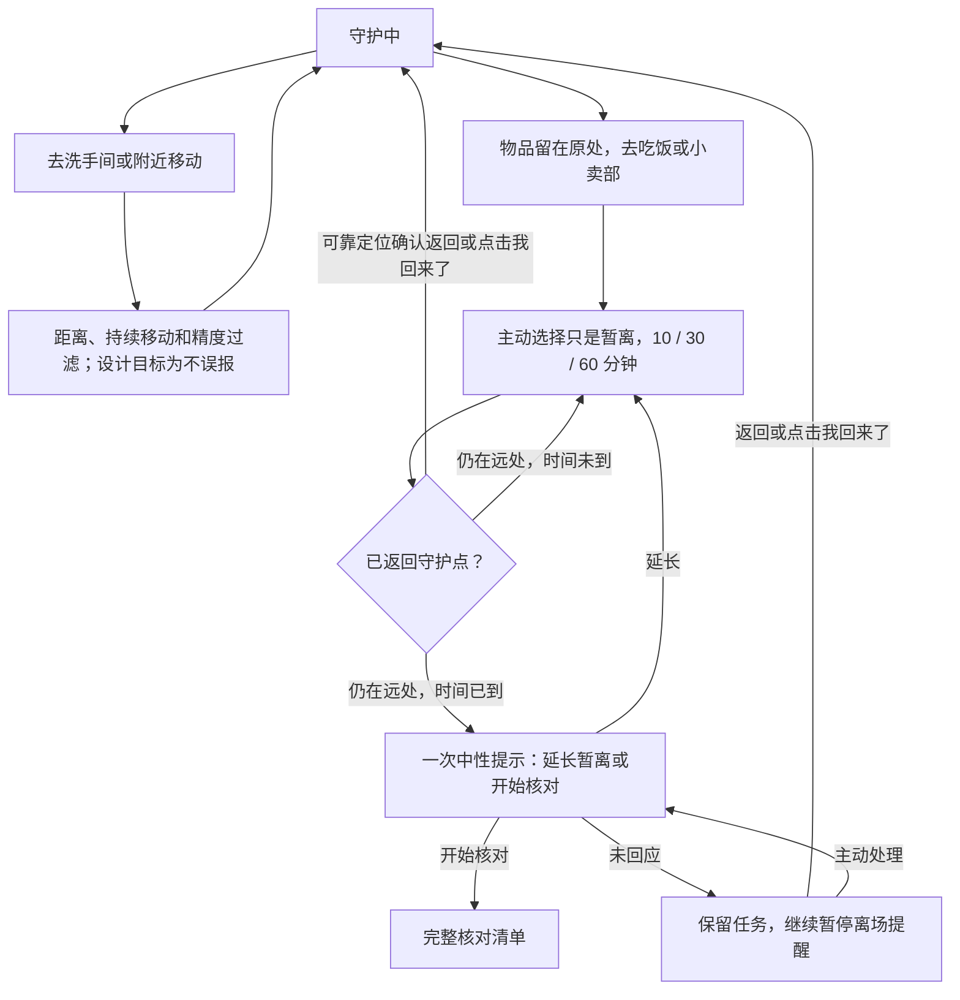
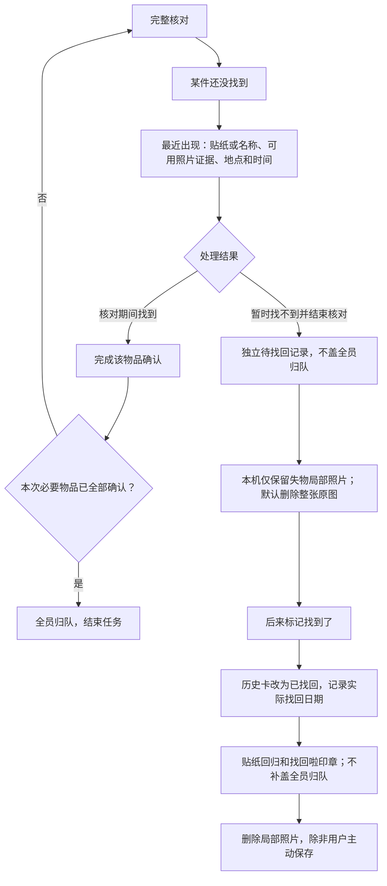

@wiki id=dont-lost-it-user-flows type=runbook domain=projects state=draft
@summary Markdown user flows derived from confirmed interaction decisions; low-fidelity screens and clickable prototype are not yet built.
@terms 用户流程, 低保真, 守护, 暂离, 找回, 分享
@links dont-lost-it-interaction-decisions, dont-lost-it-prd, dont-lost-it-prototype-plan

# 用户流程与状态说明

整理日期：2026-10-28（Asia/Shanghai）；原型连接更新于 2026-10-29。

本页将既有 PRD 与[已确认的设计决策](interaction-decisions.md)整理为 Markdown 流程。图中节点表示行为和分支；对应界面已连接为[低保真可点击原型](low-fidelity-page-inventory.md)，但系统权限、定位和动画均为模拟，尚未经过新用户或真机验证。

## 导航

```text
手账
├─ 今日手账 / 当前守护
├─ 日历 → 历史手账 → 守护卡 / 待找回记录
├─ 拍照剪贴（主入口）
└─ 从已有物品开始（次入口）

物品栏
├─ 具体物品 → 贴纸版本 / 重要程度 / 最近出现
└─ 包包模板 → 选择今天实际携带的物品

右上角 → 设置
```

## 1. 首次使用与开始

1. 直接打开空白今日手账，显示一句用途说明和主操作。
2. 用户选拍照，或通过次入口选择已有物品。
3. 有未完成草稿时，可继续整理或丢弃；草稿不显示为正在守护。
4. 同一时间已有守护任务时，先进入旧任务核对，再开启新任务。

## 2–4. 拍照、剪贴、身份与确认



确认页包含本次物品、可编辑建议名称、可选“重要”开关、“还有没拍到的东西吗？”与“添加物品”。未入镜且无已有贴纸的新物品，用手写名称标签表示。新物品不逐件弹窗命名。已有物品可沿用旧贴纸，不要求重新抠图。

剪贴动画不阻塞连续点选，熟悉物品可一键剪下全部；用户确认后自动排版，无需先手工装饰。

## 5. 守护中与较远距离暂离

守护页始终能“准备离开，开始核对”，也可补充物品或主动选择“只是暂离”。补充物品沿用当前地点和手账卡。自动提醒不可用时明确展示手动模式，不伪装成后台提醒已生效。



图中的“主动处理”是用户重新打开已有暂离状态，不表示系统循环发送到期通知。定位不可用时使用“我回来了”恢复；具体返回判定阈值待真机验证。

## 6. 离场提醒与核对

1. 用户主动点击核对，或距离与持续移动满足策略后收到离场提醒。
2. 首次提醒只展示 2–3 件物品作为样本，必须明确它不是完整清单。
3. “只是暂离”进入上述暂离流程；“准备离开”打开完整清单。
4. 每件普通物品可标记“已带走 / 还没找到”，也可一键确认普通物品。
5. 重要物品必须逐件确认，普通物品的一键按钮不包含重要物品。
6. 初次提醒未回应且继续移动、仍有重要物品未确认时，按既有策略最多追加一次直接提醒；不无限追问。
7. 离场核对中全部带齐，结束本次任务并盖“全员归队”。

## 7. 待找回与后续找回



只有名称、没有照片证据的物品，展示已有名称与记录，不生成虚假的原图高亮。独立待找回记录不占用当前守护任务名额。找回动画只在确认时播放，回看静态，提供减少动态效果版本；时长等参数未定。

## 8. 每日手账、历史与分享

1. 同一天的多次守护按时间收纳为不同卡片；不同地点的物品清单不混成一次守护。
2. 通过日历查看历史。区分“全员归队”“待找回”“已找回”，后续找回注明真实日期。
3. 分享时默认带入手账物品，用户可在预览中隐藏个别物品。
4. 精确地点、详细时间和重要标记默认隐藏，可用模糊场景描述。
5. 用户确认最终预览后导出竖版卡片。

## 已制作及后续验证

- 八条流程的低保真页面、具体文案与可点击连接已写入[页面清单与原型](low-fidelity-page-inventory.md)。
- 草稿恢复、错误身份修正、权限拒绝、识别失败等恢复路径已连接并完成开发者走查。
- 仍需通过新用户测试验证暂离持续暂停、返回恢复、单一当前任务及独立待找回的理解程度。
- 真实 iPhone 的离场与返回判定能力尚未验证；可点击原型不代表技术验证已通过。

本页不选择最终视觉风格、技术栈、最小 iOS 版本或定位阈值。阶段验收见[开发流程](../planning/development-process.md)，原型范围见[原型计划](prototype-plan.md)。
